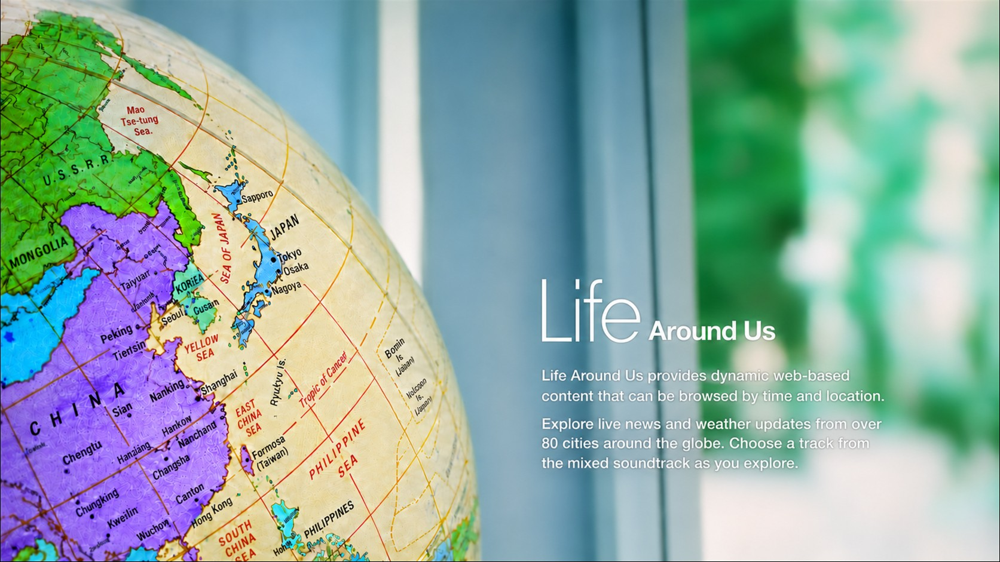
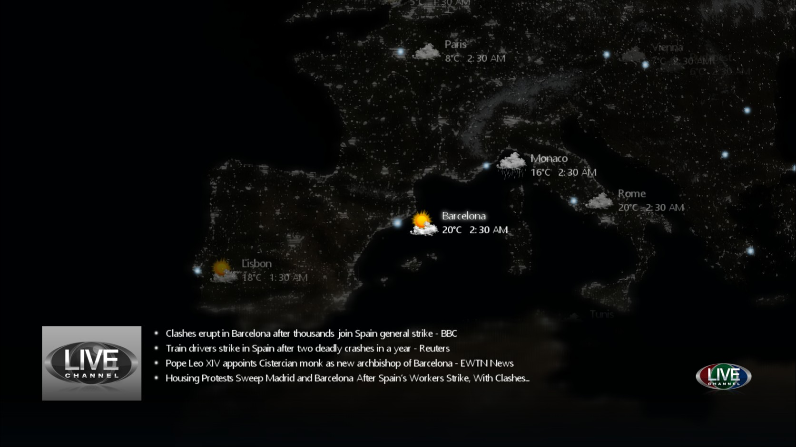
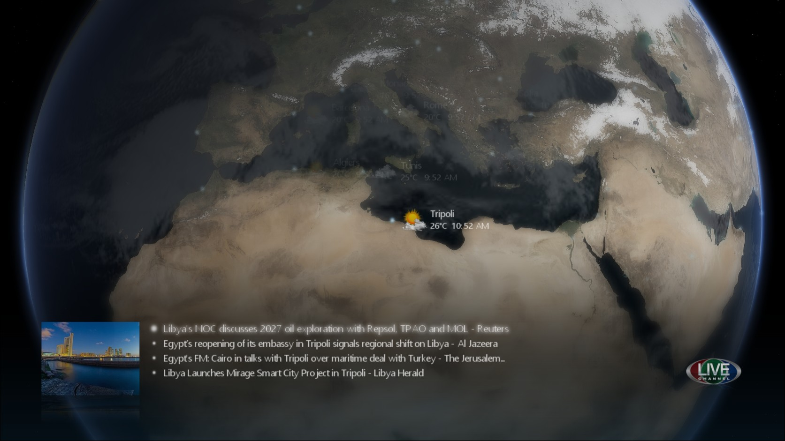
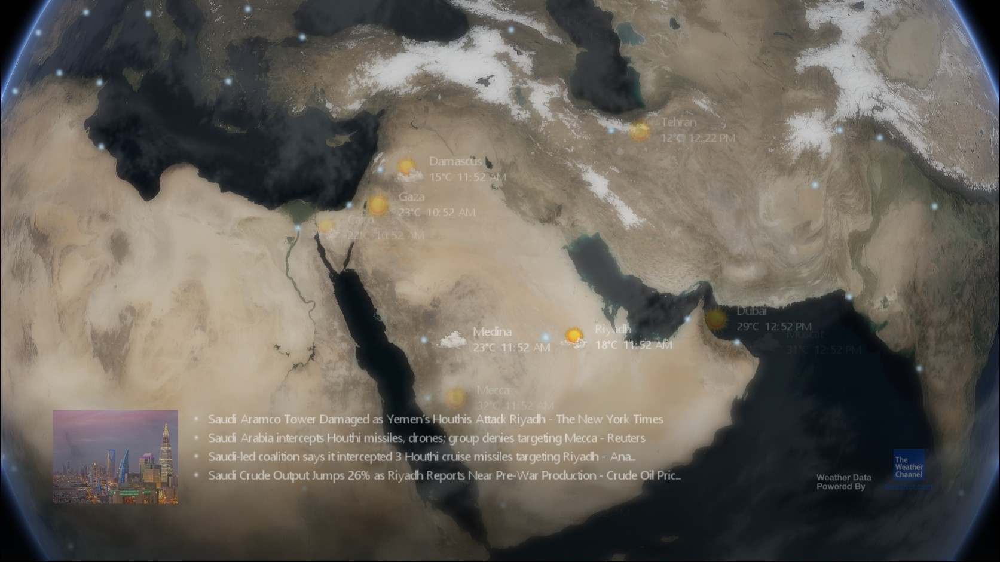
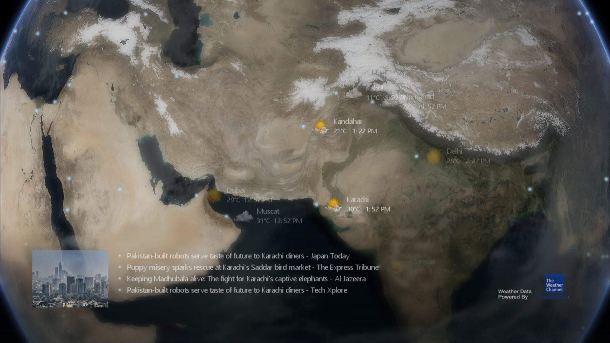
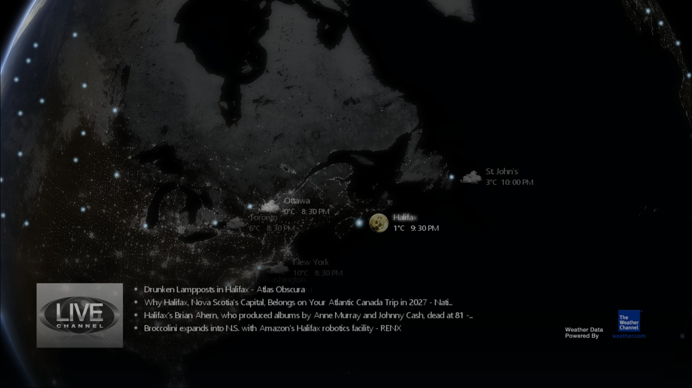
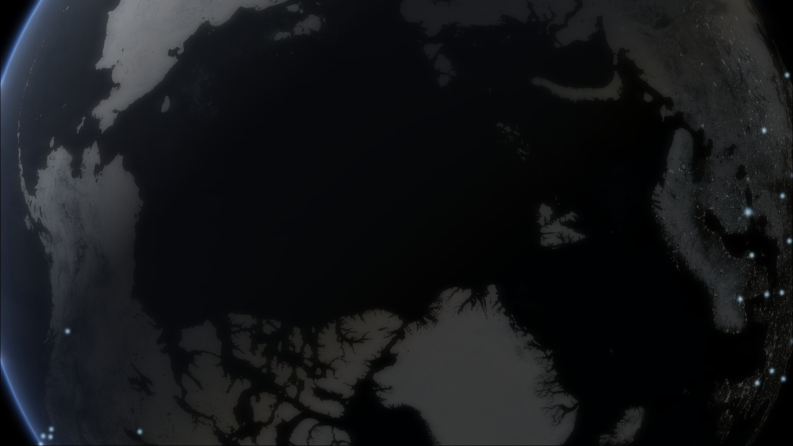
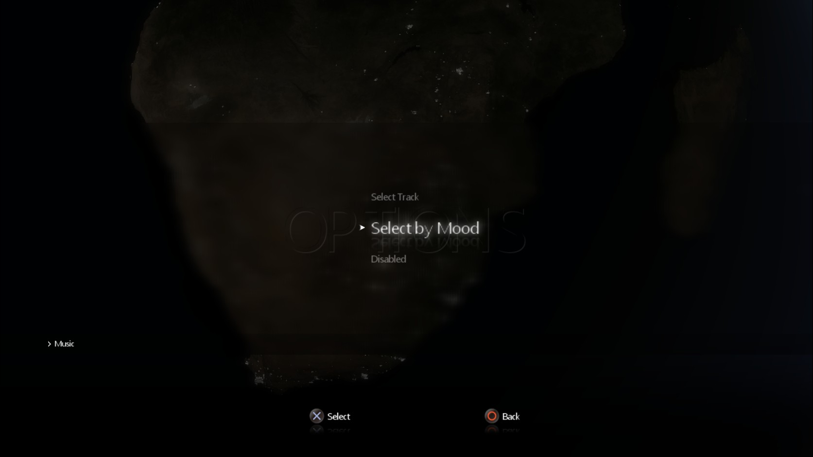
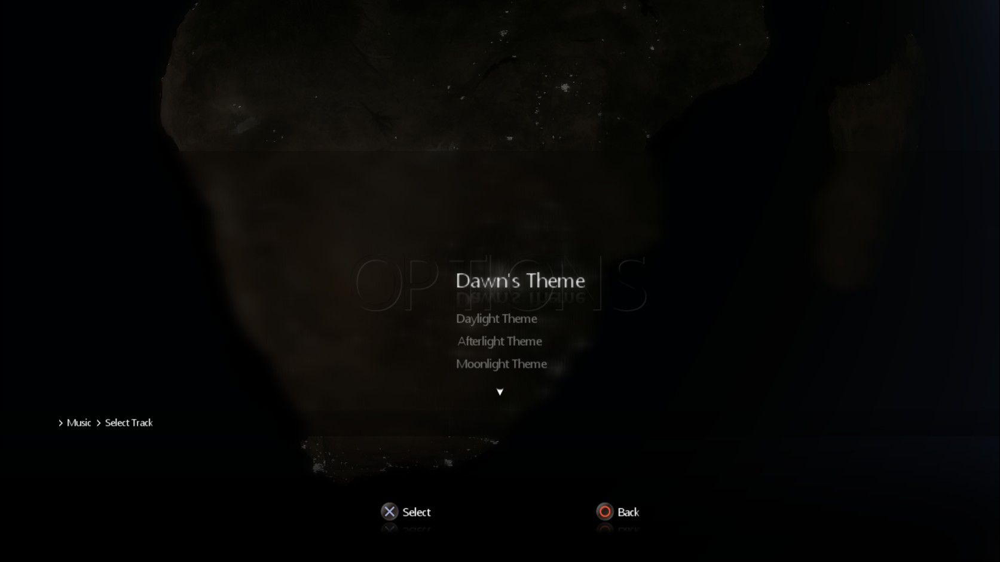
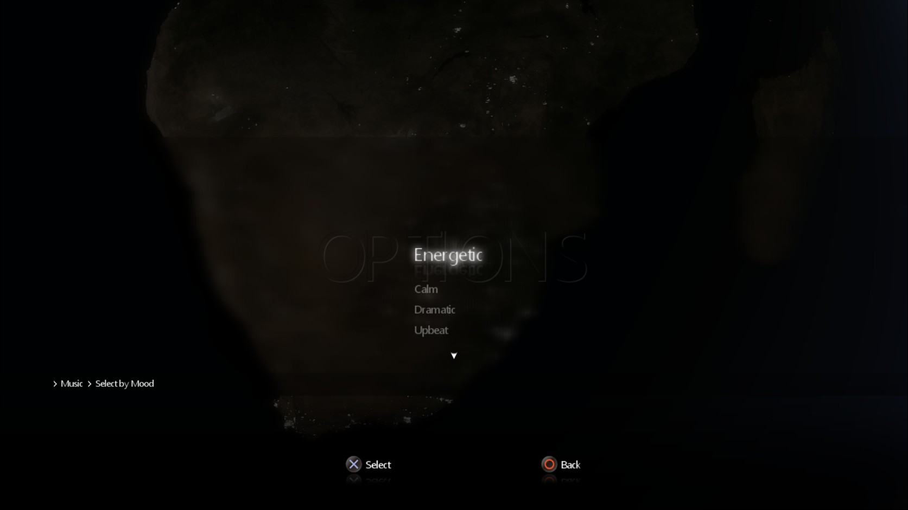

# Life Around Us

**A native Windows PC version of *Life with PlayStation*, the PS3 app that put a live, spinning Earth on your TV.**

Life with PlayStation (2008) showed a 3D globe with live news, weather and city photos from around the world. Its servers shut down in 2012, and it only ever ran on a PS3. **Life Around Us** brings it back as a real Windows program with a modern refresh. It is not an emulator: the PS3 code is recompiled into native x86-64 code that renders through DirectX 12.

You build it yourself from **your own copy** of Life with PlayStation v1.00. This repository and the build kit contain **no Sony files**.



> **v1.5:** the start-up screen now says over 110 cities.
>
> **New in v1.4:** play your own music (a Music folder on your Desktop, with a My Music menu), a NASA Earth that changes with the month, newer night lights with glowing cities, the Milky Way behind the stars, 7 more live webcams, and Miami, Kingston and Santo Domingo. See the [patch notes](CHANGELOG.md).

---

## Screenshots

| | |
|---|---|
|  |  |
| *Europe at night: city lights, live weather and local time* | *Each city's panel shows live headlines and a photo* |
|  |  |
| *Weather icons and temperatures across the Middle East* | *New cities: Karachi, Kandahar, Kabul, Islamabad, Delhi, Mumbai* |
|  |  |
| *Eastern Canada at night* | *Spin the globe anywhere, even over the pole* |

| | | |
|---|---|---|
|  |  |  |
| *The options menu: Settings and Music* | *Pick a track by name* | *Or pick by mood* |

---

## Features

Features **in bold** are new in Life Around Us. The rest come from the original PS3 app.

**The globe**
- 3D Earth with a real day/night cycle and glowing city lights at night
- Rotate and zoom with the controller
- Auto tour: when left alone, the camera flies from city to city
- Live cloud cover over the globe
- **Today's real cloud map, downloaded at every start**
- **Twinkling stars in space, with the Milky Way behind them**
- **A NASA Earth for every month: snow in northern winters, green summers (NASA Blue Marble)**
- **Newer, more detailed night lights (NASA Black Marble 2016) with a soft glow round big cities**
- **Smoother globe edges (edge anti-aliasing)**
- **The auto tour starts after 10 seconds idle (was 15) and visits every city once before any city comes round again**

**Live Channel**
- City markers with weather icons and temperatures
- News headlines for each city
- City photos in the info panel
- **Working again: live news (Google News), weather (Open-Meteo) and city photos (Wikipedia), refreshed every time you open the app and every 3 hours while it runs on its own**
- **Breaking news first: "Breaking", "Just in" and "Live updates" headlines go to the top**
- **Live webcams: Hong Kong, Chicago, Vienna, Berlin, Seattle, Paris, London, Sydney, Toronto, Las Vegas, Wellington, Salt Lake City and Boise show a current camera picture of the city (marked LIVE) instead of a photo**
- **133 cities (the original had about 33), including Seattle, Las Vegas, Honolulu, Miami, Kingston, Santo Domingo, Caracas, Brasília, Reykjavík, Lisbon, Istanbul, Athens, Vienna, Stockholm, Aleppo, Baghdad, Tashkent, Kathmandu, Delhi, Mumbai, Karachi, Malé, Hanoi, Jakarta, Taipei, Perth and more**
- **Earthquakes: every magnitude 6.0+ quake from the last 3 hours appears on the globe with a red marker, its location, depth and time (U.S. Geological Survey data). When a new one comes in, the globe flies to it for 10 seconds, then the auto tour carries on**
- **Hurricanes, typhoons and cyclones: every Category 4 or 5 storm in any ocean appears at its last reported position with its name, category and wind speed (GDACS data, with NOAA and JTWC advisories)**
- **The International Space Station: a marker that follows the real ISS across the globe second by second**
- **Local time next to every city (set at start-up and at each 3-hour refresh)**
- **Temperatures in whole degrees (15 °C, not 14.8 °C)**
- Celsius or Fahrenheit, **now in the options menu: Settings > Weather > Temperature**
- **Clouds and cities shown together**
- **A "Your City" card with your local weather and time, shown in rotation with the credits**
- **News headlines no longer open a pop-up you can't close**

**Music and sound**
- The original soundtrack and sound effects
- **Music menu: Select Track (Dawn's, Daylight, Afterlight, Moonlight and Starlight Theme) or Select by Mood (Energetic, Calm, Dramatic, Upbeat, Electronic)**
- **Soft ocean-wave ambience under the music**
- **A new track, ThemeSong06, played first at start-up, then ThemeSong03, then the rest of the soundtrack, over and over**
- **Your own music: put songs in a folder called `Music` on your Desktop (MP3, M4A/AAC, Apple Lossless, FLAC, WAV or WMA). They play after the soundtrack; Music > My Music lets you pick one or play only yours, and Music > Original Soundtrack goes back to the original loop**
- **Cleaner sounds: the globe-rotation sound stays, the old scrolling noise is gone, and a jingle plays when you snap to a city**

**PC version**
- **Native Windows program (no emulator) using DirectX 12**
- **Full screen by default; Alt+Enter or F11 switches between full screen and a window**
- **Controller rumble when the globe arrives at a new earthquake: 2 to 4 pulses, stronger for bigger quakes (DualSense, DualShock 4 and Xbox controllers)**
- **Smooth 60 fps**
- **Renders at 1440p on stronger graphics cards and 1080p on weaker ones (tested on integrated Intel graphics)**
- **Sharp text on high-DPI screens, 16x texture filtering and image sharpening**
- **No PlayStation Network or sign-in needed**
- **DualSense, DualShock 4, Xbox controllers and keyboard**
- **One-click installer with Desktop and Start menu shortcuts and an uninstaller in Settings > Apps**
- **New "Life Around Us" splash screen, logo and app icon**

---

## What you need

| | |
|---|---|
| **Your own Life with PlayStation** | Version **1.00** (title ID **NPIA00002**), extracted from its PKG (see Step 1) |
| **Windows** | Windows 10 or 11, 64-bit |
| **Graphics** | Any DirectX 12 graphics card, including recent Intel integrated graphics |
| **Memory** | 8 GB or more recommended |
| **Disk space** | About 5 GB free during the build; the installed app is about 500 MB |
| **Internet** | Needed for the build (it downloads two free tools and NASA's Earth images, about 1 GB in all) and for live news and weather |
| **Visual C++ Redistributable** | Most PCs already have it. If the build asks, get it [from Microsoft](https://aka.ms/vs/17/release/vc_redist.x64.exe) |

---

## How to build and install (step by step)

### Step 1: Get your Life with PlayStation files

The kit needs the **extracted** contents of the Life with PlayStation v1.00 PKG: a folder with **`PARAM.SFO`** and a **`USRDIR`** folder inside it (with `EBOOT.BIN`, `lwp.self` and a `prx` folder).

Use files from a copy you own. Two common ways to get that folder:

**Option A: with RPCS3 (easiest)**
1. Download [RPCS3](https://rpcs3.net/download) and open it.
2. Choose **File > Install Packages/Raps/Edats** and select your Life with PlayStation `.pkg` file.
3. When it finishes, open the folder where you put RPCS3.
4. Go to **`dev_hdd0\game\NPIA00002`**. That folder (with `PARAM.SFO` and `USRDIR`) is the one you'll pick in Step 3.

**Option B: from your own PS3**
Copy the installed app folder **`/dev_hdd0/game/NPIA00002`** off your PS3 to your PC with an FTP client or a USB drive.

> The kit checks every file. If your copy isn't the exact v1.00 release, it tells you and stops, so nothing half-built gets made.

### Step 2: Download the build kit

1. Go to [**Releases**](../../releases/latest) and download **`Life-Around-Us-Build-Kit.zip`** (about 53 MB).
2. Right-click the zip and choose **Extract All...**
3. Extract it to a normal folder, such as **Documents** or **Desktop**.
   > Don't run it from inside the zip or from a temporary folder: RPCS3 (used to decrypt your files) refuses to run from temporary folders.

You'll get a folder called **`Life Around Us Build Kit`** with:
```
Life Around Us Build Kit\
  Build Life Around Us.cmd   <- double-click this
  README.txt
  kit\
```

### Step 3: Build

1. Double-click **`Build Life Around Us.cmd`**.
   - If Windows SmartScreen says "Windows protected your PC", click **More info**, then **Run anyway**.
2. A folder picker opens. Pick your **NPIA00002** folder from Step 1 (the folder with `PARAM.SFO` and `USRDIR` inside, or any folder up to three levels above it).
   - You can also drag the folder onto `Build Life Around Us.cmd`.
3. Wait. The window shows each step:

   | Step | What it does | Time |
   |---|---|---|
   | 1/7 | Checks the kit and your 558 game files | seconds |
   | 2/7 | Downloads RPCS3 (37 MB) and the llvm-mingw compiler (190 MB), pinned versions checked by SHA-256 | a few minutes |
   | 3/7 | Decrypts the programs in your copy | under a minute |
   | 4/7 | Turns the PS3 programs into C++ | a few minutes |
   | 5/7 | Compiles the C++ into a native Windows program | 5 to 60 minutes, depending on your PC |
   | 6/7 | Copies your game data and applies the Life Around Us changes | a minute |
   | 7/7 | Makes **`Life Around Us Setup.exe`** | seconds |

   On a recent 12-thread laptop the whole build took **8 minutes**.

### Step 4: Install

1. When the build finishes, it asks **"Install Life Around Us on this PC now [Y,N]?"**. Press **Y**.
   - Or run **`Life Around Us Setup.exe`** from the kit folder later. You can copy that setup to your other PCs.
2. Click **Yes** to install. No admin rights are needed.
3. Life Around Us opens when it's done. Next time, use the **Life Around Us** shortcut on your Desktop or in the Start menu.

To uninstall, go to **Settings > Apps > Installed apps > Life Around Us > Uninstall**.

---

## Controls

| Action | Controller | Keyboard |
|---|---|---|
| Move between cities | Left stick / D-pad | Arrow keys |
| Rotate the globe | Right stick | I J K L |
| Select | Cross (A) | Z or Space |
| Back | Circle (B) | X or Backspace |
| Options menu (music) | Triangle (Y) | S or Esc |
| Full screen / window | | Alt+Enter or F11 |
| Quit | | Close the window or Alt+F4 |

A DualSense or DualShock 4 works over USB or Bluetooth without Steam or DS4Windows. Xbox controllers work too.

---

## Troubleshooting

| Message or problem | What to do |
|---|---|
| *"This is not an unmodified Life with PlayStation v1.00 (NPIA00002) PKG"* | Use the v1.00 files exactly as they came from the PKG. Updated or modified copies are refused. |
| *"That folder does not hold an extracted Life with PlayStation PKG"* | Pick the `NPIA00002` folder, the one that contains `PARAM.SFO` and `USRDIR`. |
| *"The kit is in a temporary folder"* | Extract the zip to Documents or Desktop, then run the build again. |
| *"RPCS3 did not run"* | Install the [Visual C++ Redistributable (x64)](https://aka.ms/vs/17/release/vc_redist.x64.exe), then build again. |
| *"The build kit has been changed or is incomplete"* | Download the kit again and extract it fresh. The kit refuses to build if any of its files were changed. |
| A download fails | Check your internet connection and run the build again. Finished downloads are kept. |
| No news or weather in the app | They need an internet connection. Offline, the app shows the last news and weather it got. |

---

## How it works

1. **Decrypt.** [RPCS3](https://github.com/RPCS3/rpcs3) decrypts `EBOOT.BIN`, `lwp.self` and the 21 `.sprx` libraries from your copy, using the key the app itself passes between its programs.
2. **Recompile.** The PowerPC code is lifted to C++ with [ps3recomp](https://github.com/sp00nznet/ps3recomp), then compiled to native x86-64 code with [llvm-mingw](https://github.com/mstorsjo/llvm-mingw).
3. **Run.** A Windows runtime stands in for the PS3: graphics through DirectX 12, audio through WASAPI, controllers through HID and XInput, and a local server that feeds the app live news, weather and photos.
4. **Patch.** Life Around Us changes (menus, sounds, settings, the logo) are applied to your copy as patches, so no original files ship with the kit.

---

## FAQ

**Is this an emulator?**
No. The PS3 code is recompiled ahead of time into a native Windows program. RPCS3 is used only during the build, to decrypt your files.

**Why do I have to build it myself?**
Life with PlayStation belongs to Sony. Building from your own copy means nobody has to share Sony's files.

**Can I put it on my other PCs?**
Yes. Copy the `Life Around Us Setup.exe` you built to your own PCs and run it there.

**Does it need PlayStation Network?**
No. Sign-in is removed. News comes from Google News, weather from Open-Meteo, photos from Wikipedia and clouds from a public cloud map.

**What does "Your City" use?**
On each start, the app looks up your approximate city from your internet connection (via get.geojs.io) to show your local weather and time. To set it yourself, put a file called `my_city.txt` in the app folder (`%LOCALAPPDATA%\Programs\Life Around Us`) containing a line like `Paris, 48.86, 2.35`.

**Can I switch to Fahrenheit?**
Yes. Press Triangle (or S) for the options menu, then **Settings > Weather > Temperature > Fahrenheit**. The app remembers your choice.

**Why don't I see any earthquakes?**
Only quakes of magnitude 6.0 or stronger from the last 3 hours are shown. The list is checked when you open the app and every 3 hours after that. Worldwide there are only a few a month, so most of the time there are none.

**How does the live refresh work?**
Every 3 hours the app fetches new news, weather, webcam pictures and earthquakes. It waits until nobody has touched the controller for 10 seconds (or the auto tour is running), then reloads itself in a couple of seconds. The music carries on where it left off. If you're using it, it waits until you stop.

**Why don't I see any hurricanes?**
Only Category 4 and 5 storms are shown (winds of 209 km/h / 130 mph or more). Most of the year there are none; they appear during the strongest storms of each season.

**Can I turn the rumble off?**
Yes. Set the environment variable `LWP_RUMBLE` to `0` before starting the app. Each quake rumbles only once, the first time the globe shows it.

**Can I add my own music?**
Yes. Make a folder called `Music` on your Desktop and put songs in it (subfolders work too): MP3, M4A/AAC, Apple Lossless, FLAC, WAV or WMA. Restart the app. Your songs play after the soundtrack; **Music > My Music** lists them (up to 50) and **Music > Original Soundtrack** goes back to the original loop.

**Can I go back to the original Earth?**
Yes. Set the environment variable `LWP_EARTH` to `classic`, or delete the `world_nasa` folder (in the app folder, under `vfs/PS3_GAME/USRDIR/data`). `LWP_MILKYWAY=0` turns the Milky Way off.

---

## Credits and legal

- **Life with PlayStation** © Sony Interactive Entertainment. "PlayStation" and "Life with PlayStation" are trademarks of Sony Interactive Entertainment. **This project is fan made revival for PC, not made, approved or supported by Sony.**
- **[ps3recomp](https://github.com/sp00nznet/ps3recomp)** (MIT License, Ned Heller / sp00nznet): the PS3 recompiler and runtime.
- **[RPCS3](https://github.com/RPCS3/rpcs3)** (GPL-2.0): downloaded during the build, used only to decrypt your files.
- **[llvm-mingw](https://github.com/mstorsjo/llvm-mingw)** (Apache-2.0 with LLVM exception): downloaded during the build to compile.
- **[Python](https://www.python.org/)** (PSF License), **[Pillow](https://python-pillow.org/)** (MIT-CMU), **[NumPy](https://numpy.org/)** (BSD-3-Clause): included in the kit.
- News: [Google News](https://news.google.com) · Weather: [Open-Meteo](https://open-meteo.com) (CC BY 4.0) · City photos: [Wikipedia / Wikimedia Commons](https://commons.wikimedia.org) contributors · Cloud map: [clouds.matteason.co.uk](https://clouds.matteason.co.uk)
- Earthquakes: [U.S. Geological Survey](https://earthquake.usgs.gov) · Storms: [GDACS](https://www.gdacs.org) · ISS position: [wheretheiss.at](https://wheretheiss.at), photo: NASA · Webcams: [Hong Kong Observatory](https://www.hko.gov.hk), [NOAA GLERL](https://www.glerl.noaa.gov), [foto-webcam.eu](https://www.foto-webcam.eu), [berlin.de](https://www.berlin.de/webcams/), [Roundshot](https://www.roundshot.com), a public YouTube live stream (Paris), and the traffic cameras of Transport for London, Transport for NSW, NZ Transport Agency, Nevada DOT, Utah DOT, Ontario 511 and Idaho 511
- Earth: NASA Blue Marble Next Generation and Black Marble 2016 (NASA Earth Observatory, public domain)

